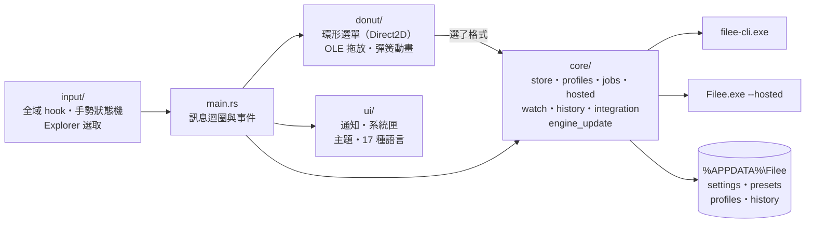

# filee-rust

**Filee 的 Rust 常駐版**：按住 Ctrl 拖檔案就跳出環形選單轉檔，功能跟原版一樣，常駐記憶體從約 300 MB 降到十幾 MB 的目標。
安裝後的程式名稱是 **Filee Rust**（2026-10-29 以前叫 Filee Lite；舊版可以直接用新的安裝檔原地升級，設定不會丟）。

[Filee](https://github.com/KnifeLemon/Filee) 是很好用的離線轉檔工具：在檔案總管按住 Ctrl 拖檔案，跳出環形選單，放下就轉好
（圖片、PDF、Office、影音、電子書、CAD… 263 種格式）。它用 C#／Avalonia 寫成，一直開著就要
**Working Set 299 MB、Private 213 MB、95 個執行緒**（2.2.0 閒置實測）。

這個專案把「一直開著」的那一層用 Rust 重寫，轉檔與互動視窗仍交給上游 Filee，用完就結束：

- 常駐的 `filee-rust.exe` 只負責等手勢、畫環形選單、顯示進度、系統匣、自動轉換資料夾。
- 真正轉檔時才叫上游的 `filee-cli.exe`，轉完就結束（PNG→WebP 實測 0.53 秒、峰值 89 MB，結束即釋放）。
- 設定頁、裁切、剪輯、PDF 頁面編輯、列印工作室這些視窗，要用時才臨時開上游的 Filee，關掉就結束。
- 設定、預設、轉換紀錄跟上游**共用同一份**（`%APPDATA%\Filee`），從原版換過來什麼都不用重設。
- 上游出新版時，一條指令就能抓新版、產生差異報告、重套補丁、重新編譯、打包成新的安裝檔。

> 非官方的改版，與 Filee 原作者及 Microsoft 無關。

## 目錄

- [架構](#架構)
- [功能](#功能)
- [安裝](#安裝)
- [使用](#使用)
- [轉換引擎](#轉換引擎)
- [自動更新](#自動更新)
- [設定與檔案位置](#設定與檔案位置)
- [從原始碼建置](#從原始碼建置)
- [上游出新版時](#上游出新版時)
- [對上游的補丁](#對上游的補丁)
- [專案結構](#專案結構)
- [已知限制](#已知限制)
- [授權](#授權)

## 架構


三個程式，三種壽命：

| 程式 | 什麼時候在跑 | 負責 |
|---|---|---|
| `filee-rust.exe`（Rust） | 一直開著 | 全域滑鼠鍵盤 hook、手勢判斷、環形選單、進度通知、系統匣、右鍵選單、自動轉換資料夾、轉換紀錄、300 DPI 政策、每週引擎更新 |
| `app\filee-cli.exe`（上游） | 每次轉檔一個，轉完結束 | 實際轉檔（`convert --preset <id> --json`）、可轉格式表（`formats`） |
| `app\Filee.exe --hosted`（上游＋補丁） | 要開視窗時才開，關掉就結束 | 設定視窗、互動工具（裁切、剪輯、頁面編輯、列印工作室）、合併順序、每次詢問存檔位置 |

三者讀寫同一組 `%APPDATA%\Filee\*.json`，所以在上游設定頁改的東西，常駐的外殼馬上生效。
上游存檔時是整檔覆寫、不會重讀，所以上游視窗開著時，外殼的寫入會先排隊，等它關掉再寫。

Rust 外殼內部的模組：



| 模組 | 負責 |
|---|---|
| `input/` | `WH_MOUSE_LL`／`WH_KEYBOARD_LL`（只聽不攔）、手勢狀態機（門檻、晚到的修飾鍵、Hold）、只在檔案總管與瀏覽器生效、排除程序、讀取 Explorer 選取（含 Win11 分頁與桌面） |
| `donut/` | 分層透明視窗、Direct2D 繪製、彈簧動畫、正反面翻轉、群組子環、OLE `IDropTarget`（含 Chrome／Edge 虛擬檔、Firefox 暫存檔） |
| `ui/` | 進度與結果通知、系統匣、主題（Soft／Material You、深淺色、強調色）、上游的 i18n 檔 |
| `core/` | 上游資料檔（保序讀寫、格式照上游）、依檔案類型選面與停用原因、呼叫 CLI 與進度、開上游視窗、自動轉換資料夾、轉換紀錄、右鍵選單與 300 DPI、每週引擎更新 |

移植時逐條對照上游原始碼寫成的規格在 [`docs/spec/`](docs/spec/)（每一點附上游的檔案與行號），研究與實測數字在
[`docs/research.md`](docs/research.md)。

## 功能

| 功能 | 說明 |
|---|---|
| Ctrl＋拖曳 | 在檔案總管（或瀏覽器）按住 Ctrl 拖檔案，游標旁跳出環形選單，拖到格式上放開就轉 |
| 選取後轉換 | 選好檔案按 **Ctrl+Alt+Space**，選單出現在游標旁，用滑鼠或鍵盤選 |
| 右鍵選單 | 檔案上按右鍵 →「用 Filee 轉換」，多選也可以 |
| 依檔案類型選面 | 圖片、PDF、Office、影音、電子書、CAD… 各有自己的選單，跟上游的設定一樣 |
| 正反面與群組 | Tab 或滾輪翻到背面看更多格式；群組點開是子環（最多 6 個） |
| 停用原因 | 少了引擎或格式不支援的項目會變灰，並說明原因 |
| 進度通知 | 右下角顯示逐檔進度，完成後可開啟檔案或資料夾，可取消、可重試失敗的檔 |
| 互動工具 | 裁切、剪輯、PDF 頁面編輯、列印工作室、圖片編輯、馬賽克：開上游的視窗，功能完全相同 |
| 自動轉換資料夾 | 檔案放進指定資料夾、穩定 2 秒後自動轉，原檔可搬到 originals，規則跟上游相同 |
| 轉換紀錄 | 寫進上游的 `history.json`，上游首頁看得到，也能復原 |
| 系統匣 | 左鍵開設定；右鍵開啟、暫停、結束 |
| 主題與語言 | 跟上游同一套主題設定與 17 種語言 |
| 300 DPI | 任何轉成圖片的預設一律 300 DPI（PDF／文件頁面轉圖片的解析度與檔案標記） |
| PDF 轉 Office | PDF 選單的「轉成 Office」群組：DOCX、XLSX、PPTX（取代只在多選時有用的「合併 PDF」，只改一次，之後照你的設定） |
| Microsoft Office 優先 | Office 文件用你電腦上的 Word／Excel／PowerPoint 轉，不能用時改用 LibreOffice（見下方〈轉換引擎〉） |
| 每週引擎更新 | 背景靜默更新轉換引擎，不開視窗、不打擾 |
| 自動更新 | Filee Rust 自己從 GitHub Release 更新到新版（只收發佈者簽過名的版本）；系統匣可手動「檢查更新」 |
| 本機識別碼 | 每台一組隨機識別碼，發佈者可以只把新版推給指定的電腦 |

## 安裝

這個 repo 不提供編好的安裝檔，請照〈[從原始碼建置](#從原始碼建置)〉產生 `dist\FileeRust-<版本>-Setup.exe`，
再帶到任何一台 Windows 10（1809 以後）／11 x64 安裝。

1. 執行安裝檔。安裝檔沒有簽章，Windows 會跳 SmartScreen：按「其他資訊」→「仍要執行」。
2. 預設裝給目前使用者（`%LOCALAPPDATA%\Programs\Filee Rust`，不需要系統管理員），也可以選裝給所有使用者。
   安裝選項**全部預設勾選**：
   - 登入 Windows 時自動啟動
   - 7-Zip 解壓縮引擎：ZIP、7Z、RAR、TAR、ISO 光碟映像。放在安裝檔裡，不用下載。
   - 每週自動更新轉換引擎（見〈[轉換引擎](#轉換引擎)〉）
   - 線上安裝轉換引擎：由 Filee 自己的下載器下載，每個檔都驗 SHA-256，不需要系統管理員
     - LibreOffice（開源 Office 套件，沒有可用的 Microsoft Office 時接手）
     - Tesseract（OCR）
     - Pandoc（Markdown）
     - Ghostscript（EPS、PS）
     - FFmpeg（影音）
     - Calibre（電子書）

   圖片、資料（CSV、JSON、XML…）、2D 製圖（DXF、DWG）、PDF、向量、3D 模型的轉換都是內建的，不用另外裝。

   按「完成」後 Filee Rust 會自動啟動，並打開設定視窗。最後一頁的「閱讀說明（README）」預設不勾。
3. 電腦上有原版 Filee 的話，安裝程式會請它先結束。建議之後到「設定 → 應用程式」解除安裝原版，兩個同時開會跳兩個選單。
4. 防毒軟體把 `filee-rust.exe` 擋下或刪掉的話，把安裝資料夾加入信任。它會偵測全域滑鼠鍵盤（只聽不攔），
   沒簽章的程式這樣做容易被誤判。

第一次啟動時，如果這台電腦從沒用過原版 Filee，外殼會請上游寫出它的預設選單，所以一裝好就有完整的選單。

## 使用

| 動作 | 做法 |
|---|---|
| 轉檔 | 在檔案總管按住 **Ctrl** 拖檔案 → 拖到環形選單的格式上放開 |
| 轉選取的檔 | 選好檔案按 **Ctrl+Alt+Space** → 點格式，或用方向鍵＋Enter，Esc 關閉 |
| 右鍵 | 檔案上按右鍵 → 「用 Filee 轉換」 |
| 翻到背面（更多格式） | 選單開著時按 **Tab** 或滾輪 |
| 設定 | 點系統匣的 Filee 圖示（開上游的設定視窗）；開始功能表的「Filee Rust」也是 |
| 暫停／結束 | 系統匣右鍵 |
| 檢查更新 | 系統匣右鍵 →「檢查更新」 |
| 看本機識別碼 | 系統匣右鍵 →「檢查更新」下面那一項「本機識別碼：XXXX-XXXX（電腦名稱，點一下複製）」 |

指令列：

```text
filee-rust.exe                     常駐（系統匣）；已經在跑時再啟動一次會開設定
filee-rust.exe --background        常駐，不開任何視窗（登入時用）
filee-rust.exe --convert a b …     對這些檔案開環形選單（右鍵選單用；轉交給正在跑的那一個）
filee-rust.exe --convert-list f    同上，路徑一行一個（UTF-8 檔）
filee-rust.exe --settings          開上游的設定視窗
filee-rust.exe --quit              請正在跑的那一個結束
filee-rust.exe --selftest          檢查安裝（app 資料夾、CLI、翻譯、資料夾），印出報告後結束
```

## 轉換引擎

**Office 文件（Word、Excel、PowerPoint）優先交給 Microsoft Office 轉**，不能用時才用 LibreOffice：

- 「偵測到」的判準是在這台電腦上**真的試轉成功**：Word、Excel、PowerPoint 各自先轉一個小檔成 PDF，成功的才算。
  所以就算裝了 Office，只要沒啟用、裝不完整或被擋，就照樣用 LibreOffice。
- 個別檔案 Office 轉不了時，自動改用 LibreOffice，例如 Excel、PowerPoint 要輸出 PDF/A。
- 安全措施：巨集一律停用、連結不更新、檔案唯讀開啟；有密碼的檔直接失敗，不會跳出密碼視窗卡住；
  超過 5 分鐘沒反應就結束它自己開的 Office；你正在用的 PowerPoint 不會被關掉。
- 只用在你自己的電腦、你自己的 Office 授權上；沒有 Office 的電腦完全用 LibreOffice。
- 不想用 Microsoft Office：設環境變數 `FILEE_MSOFFICE=off`。

**PDF 轉 Excel** 只抓 PDF 裡**畫了格線的表格**（上游的規則）；沒有表格或掃描成圖片的 PDF 會失敗並說明原因。

**每週自動更新**：Filee Rust 常駐時一週檢查一次，在背景（不開視窗、較低優先權、沒在轉檔、沒用電池時）更新：

- Filee 自己下載的引擎（`%LOCALAPPDATA%\Filee\engines`）
- 內建的 7-Zip

版本與 SHA-256 以 Filee 最新版公布的引擎清單為準；下載網址必須跟原本是同一家發行者（同一個主機，GitHub 同一個
repo、conda 同一個 channel），而且版本要比較新，否則不採用。失敗的隔天重試。

- 用 winget 或安裝程式自己裝在系統上的 LibreOffice 等軟體，由它們各自的更新機制負責，Filee Rust 不會去動。
- 裝成「所有使用者」（Program Files）時，內建 7-Zip 沒有寫入權限，要等重裝新版才會更新。
- 不另外建立 Windows 排程工作，由常駐的外殼自己計時。

## 自動更新

Filee Rust 會自己更新，使用者不用重裝：

- 開機後檢查一次，之後每天一次，看 [GitHub Releases](https://github.com/win81134679-dot/filee-rust/releases)
  有沒有比自己新、而且是給這台電腦的版本。只升不降。
- **只收發佈者簽過名的版本**：每個 Release 附 `update.json`（版本、安裝檔名稱、大小、SHA-256、要給哪幾台）與
  `update.sig`（ECDSA P-256 簽名）。安裝檔裡附的公鑰 `update.pub` 驗不過的一律不收，所以就算有人換掉 Release 上的檔案，
  已安裝的電腦也不會裝它。
- 有新版就在背景下載（可以續傳，網路慢也沒關係），驗過大小、SHA-256 與簽名才算數。
- 在**沒有轉檔、沒開設定或工具視窗、插著電、2 分鐘沒動滑鼠鍵盤**時靜默安裝，裝完自動重新啟動，設定都保留；
  安裝失敗也會把原本的 Filee Rust 開回來。
- 失敗就只寫紀錄（`logs\self-update.log`），隔天再試，不跳任何通知。
- 系統匣的「檢查更新」是手動版：會用通知回報結果，有新版就馬上下載並安裝（轉檔中會等轉完）。
- 每台第一次啟動時產生一組隨機的**本機識別碼**（例如 `K7Q2-9XMA`，由亂數產生，不是從電腦名稱算出來的）。
  系統匣右鍵的「檢查更新」下面就是它，旁邊附這台的電腦名稱。點一下會複製一行：
  `Filee Rust 本機識別碼 K7Q2-9XMA（電腦 PC-ALICE，使用者 alice，版本 2.2.0-rust.5）`，
  同事貼給發佈者，發佈者就知道這組識別碼是哪一台。電腦名稱只在本機顯示，不會上傳，也不會寫進 Release。
- 不自動更新的情況：
  - 裝成「所有使用者」（Program Files），因為更新要系統管理員權限
  - 自己從原始碼編的開發版（沒有 `version.txt`）
  - `lite.json` 設了 `"autoUpdate": false`（手動「檢查更新」仍然可以用）

### 發佈新版（發佈者）

第一次先產生簽名金鑰（兩種擇一）：

```powershell
uv run 工具\publish.py new-key                      # 自己在終端機設密碼，之後每次發佈都要輸入
uv run 工具\publish.py new-key --generate-password  # 亂數密碼存在 keys\update-signing-password.txt，發佈時不再問
# 私鑰 keys\update-signing.pem（不進 git，用密碼加密）；公鑰 packaging\update.pub（要 commit）
```

把整個 `keys\` 資料夾另外存一份到隨身碟。**私鑰弄丟，已安裝的電腦就再也收不到更新**，只能每台手動重裝。

每次發佈（在自己電腦試過新的安裝檔之後）：

```powershell
python 工具\build_release.py                         # 建出 dist\FileeRust-<版本>-Setup.exe
python 工具\update.py --publish                      # 給每一台：簽名、以預先發行版上傳 GitHub Release
python 工具\update.py --publish --machines K7Q2-9XMA # 只給這幾台（逗號分隔；也可以用 工具\machines.json 裡的名字）
python 工具\update.py --open v2.2.0-rust.6           # 之前只給幾台的版本，開放給每一台
```

`工具\machines.json`（不進 git）記你自己的對照，例如 `{"王老師": "K7Q2-9XMA"}`，之後 `--machines 王老師` 就好。
對照怎麼來：請同事在系統匣點「本機識別碼」，把複製的那一行傳給你（含電腦名稱、使用者與目前版本）。
Filee Rust 不會回報任何資料，所以只有這個方法知道哪一台是哪一台。
要退回舊版時，把舊的內容重新編成**更高的版本號**再發佈。

需要 [uv](https://docs.astral.sh/uv/)（會自動帶 `cryptography`）與已登入的 [GitHub CLI](https://cli.github.com/)（`gh auth login`）。

## 設定與檔案位置

| 位置 | 內容 |
|---|---|
| `%APPDATA%\Filee\` | 跟上游共用：`settings.json`、`presets.json`、`profiles.json`、`history.json` |
| `%LOCALAPPDATA%\FileeLite\logs\` | 外殼的每日紀錄 `filee-rust-YYYYMMDD.log`、引擎更新紀錄 `engine-update.log` |
| `%LOCALAPPDATA%\FileeLite\lite.json` | `{"force300Dpi": false}` 關掉 300 DPI 政策；`{"autoUpdate": false}` 關掉自動更新（沒有這個檔＝都開） |
| `%LOCALAPPDATA%\FileeLite\engine-update.json` | 每週更新的狀態；`"enabled": false` 關掉 |
| `%LOCALAPPDATA%\FileeLite\policy.json` | 記錄一次性的調整（PDF 選單）已經做過 |
| `%LOCALAPPDATA%\FileeLite\machine-id.txt` | 本機識別碼 |
| `%LOCALAPPDATA%\FileeLite\self-update.json`、`updates\` | 自動更新的狀態與下載中的安裝檔 |
| `%LOCALAPPDATA%\Filee\engines\` | Filee 下載的引擎 |
| `%LOCALAPPDATA%\Filee\msoffice-check.json` | Microsoft Office 試轉結果（Office 改版就重測，失敗的隔天重測） |

`%LOCALAPPDATA%\FileeLite` 這個資料夾沿用改名前的名字，從 Filee Lite 升級時狀態才不會丟。

環境變數：`FILEE_MSOFFICE=off`（不用 Microsoft Office）、`FILEE_DATA_DIR`（資料夾改到別處，跟上游同一個變數，測試用）。

出問題時先看最新的 `filee-rust-*.log`。例如選單是空的，會有一行 `donut: no slices for …`，寫出檔案格式、用到哪組選單、
預設與選單各有幾個。

## 從原始碼建置

需要：

- Windows 10／11 x64
- [Rust](https://rustup.rs/)（MSVC 工具鏈）
- [.NET 10 SDK](https://dotnet.microsoft.com/)
- [Inno Setup 6](https://jrsoftware.org/isinfo.php)
- Python 3、Git
- Node.js（只有重畫架構圖時需要）

```powershell
git clone https://github.com/win81134679-dot/filee-rust
cd filee-rust
python 工具\update.py --init       # 抓上游原始碼（patches\UPSTREAM_TAG 記的版本，約 10 MB）並套上補丁
python 工具\build_release.py       # 建置並打包 → dist\FileeRust-<版本>-rust.<N>-Setup.exe
```

`build_release.py` 一條指令做完：

1. 確認補丁已套上
2. 下載上游的 Noto 字型（從上游的腳本解析網址與 SHA-256，不執行它）
3. `dotnet publish` 補丁版的上游
4. 下載上游官方 Portable 版並比對 `SHA256SUMS`
5. `cargo test`
6. 編譯 Rust 外殼
7. 組裝
8. `--selftest`，並真的轉一次 SVG→PNG
9. 用 Inno Setup 打包

上游的 `build\*.ps1` 等建置腳本不會被 checkout，也不會被執行。

只改外殼時：

```powershell
cd shell; cargo test; cargo build --release
$env:FILEE_LITE_APP = "$PWD\..\build\stage\app"; .\target\release\filee-rust.exe --selftest
```

會碰到真實轉檔的整合測試預設跳過，要用一份資料複本跑：

```powershell
$env:FILEE_DATA_DIR = "<專案>\shell\target\core-test\data"    # 放 settings／presets／profiles／history.json 的複本
$env:FILEE_LITE_APP = "<專案>\build\stage\app"
cargo test -- --ignored --test-threads=1 core::integration_tests
```

測試會拒絕在 `shell\target\core-test` 以外的資料夾執行，不會碰到真正的 `%APPDATA%\Filee`。

## 上游出新版時


```powershell
python 工具\update.py --check       # 只看有沒有新版（一天最多問 GitHub 一次；--force 重問）
python 工具\update.py               # 有新版就：抓 → 差異報告 → 換補丁 → 建置 → 新安裝檔
python 工具\update.py --to v2.3.0   # 換到指定版本（也可以往回）
python 工具\update.py --rebuild     # 改了 shell\ 之後重建同一版
python 工具\update.py --save-patch  # 改了 upstream\ 之後存回 patches\hosted.patch（含新檔）
```

結束碼：

| 結束碼 | 意思 |
|---|---|
| 0 | 新安裝檔在 `dist\`，可以直接帶去別台裝 |
| 2 | 安裝檔也建好了，但上游改到 Filee Rust 移植過的地方（觸發、選單、通知、資料格式、CLI 輸出），要看差異報告第 1 節 |
| 1 | 失敗，訊息會說在哪一步；補丁套不上時照提示修好再 `--save-patch`、`--rebuild` |

差異報告寫在 `docs\upstream-diffs\<舊>_to_<新>.md`：CHANGELOG 摘錄，以及每個改動的檔分成三類：
外殼要跟著改、補丁碰到的檔、自動跟上（引擎、工具、翻譯，重新編譯就有）。

架構圖是 HTML（[`docs/架構圖/HTML/`](docs/架構圖/HTML/)，含兩個動態版），用 `node 工具\render_diagram_a2.mjs <html>`
輸出 A2 300 DPI 的 PNG 與 PDF。

## 對上游的補丁

[`patches/hosted.patch`](patches/hosted.patch) 盡量小，方便每版用 3-way 套上：

1. `--hosted`：被外殼叫起來的模式。不掛 hook、不開系統匣、不跑自動轉換資料夾與更新檢查；最後一個視窗關掉、沒有工作時自己結束。
2. `--run=<preset> 檔案…`：跟在環形選單放下一樣的分流（互動工具、合併順序、每次詢問、一般轉檔）。
3. hosted 版的單一執行個體名稱加 `-lite`，不會轉送給同時開著的原版 Filee。
4. `--hosted --update-engines`：每週引擎更新，不開視窗、不拿單一執行個體鎖。
5. `--hosted --seed-data`：新電腦沒有 `presets.json`／`profiles.json` 時，用上游自己的格式寫出預設。
6. `--hosted --self-update`：Filee Rust 自己的更新（查 Release、比版本與本機識別碼、續傳下載、驗 SHA-256 與簽名）。
7. Microsoft Office 轉換器（新檔 `Filee.Engines/Office/MicrosoftOfficeConverter.cs`），排在 LibreOffice 前面，失敗就交給 LibreOffice。
8. 引擎安裝器能解開 7-Zip 的 MSI。
9. 英文與繁中的引擎說明。
10. 存設定時如果檔案剛好被別的程式開著（Filee Rust 在讀、防毒在掃），會等最多 2 秒再存；還是存不進去只記錄，不會讓視窗閃退。

## 專案結構

| 路徑 | 內容 |
|---|---|
| `shell\` | Rust 原始碼（crate `filee-rust`） |
| `patches\hosted.patch`、`patches\UPSTREAM_TAG` | 對上游的補丁，與它對應的上游版本 |
| `packaging\update.pub` | 自動更新驗簽名用的公鑰（私鑰 `keys\` 不在 repo） |
| `工具\` | `update.py`（閉環）、`build_release.py`（建置封裝）、`publish.py`（簽名發佈）、`test_install.py`（靜默安裝測試）、字型下載、300 DPI、畫圖 |
| `packaging\` | Inno Setup 腳本與繁中語言檔 |
| `docs\spec\` | 移植規格：01 觸發與環形選單、02 資料與轉檔工作、03 通知／系統匣／主題 |
| `docs\upstream-diffs\` | 每次升版的差異報告 |
| `docs\架構圖\` | 架構圖 HTML、PNG、PDF |
| `upstream\`、`build\`、`cache\`、`dist\` | 上游原始碼、建置中間檔、下載快取、安裝檔（不在 repo 裡，都可以重建） |

## 已知限制

- 從瀏覽器拖「連結」不會下載，只收瀏覽器直接給的檔案（Chrome／Edge 的圖片、Firefox 的檔案都可以）。
- `.lnk` 捷徑與搜尋結果的虛擬項目不展開。
- 上游角落的提示（有新版、回饋、格式請求、缺字型）沒有做。
- 自動轉換資料夾不支援 `/正規表達式/` 規則（glob 可以）。
- 取消是直接結束轉檔程式，可能留下轉到一半的檔。
- 安裝檔沒有程式碼簽章：Windows 會跳 SmartScreen，自動更新「下載後靜默執行安裝檔」也可能被防毒軟體當成可疑行為，需要把安裝資料夾加入信任。
- 只支援 Windows（上游另有 macOS／Linux 版，這裡只取代 Windows 的常駐層）。

## 授權

[MIT](LICENSE)。Filee 本體由 Filee contributors 以 MIT 授權；安裝檔內的 `licenses\` 附上游授權、第三方聲明與補丁全文。
「Microsoft Office」「Word」「Excel」「PowerPoint」是 Microsoft 的商標，這裡只用來描述功能。
